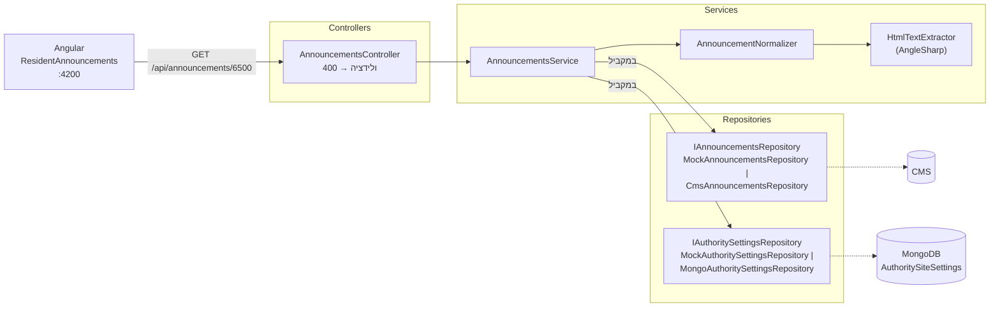

# RA_MuniAnnouncements - הודעות ועדכונים לתושב

מיקרו-שירות ב-.NET 8 שמחזיר לאתר של כל רשות את ההודעות הפעילות לתושבים, אחרי סינון ועיבוד לפי הגדרות האתר של אותה רשות (Multi-Tenancy). בנוסף יש רכיב Angular בשם "הודעות לתושב" שמציג את ההודעות ואפשר לשלב אותו בכל דף באתר.

```
GET /api/announcements/{authorityCode}
```

את ה-User Stories ושאלות ההבהרה כתבתי בקבצים נפרדים: [חלק א - User Stories.md](<חלק א - User Stories.md>) ו-[חלק א - שאלות הבהרה.md](<חלק א - שאלות הבהרה.md>). התשובות לחלקים ב' ו-ג' נמצאות ב-[חלק ב - Code Review.md](<חלק ב - Code Review.md>) וב-[חלק ג - שאלות ארכיטקטורה ואבטחה.md](<חלק ג - שאלות ארכיטקטורה ואבטחה.md>).

## מבנה הריפו

```
server/   RA_MuniAnnouncements (ASP.NET Core Web API)
tests/    RA_MuniAnnouncements.Tests (xUnit)
client/   muni-announcements (Angular)
```

---

## ארכיטקטורה



השרת הוא פרויקט אחד, מחולק לתיקיות לפי שכבה. כל שכבה פונה לשכבה שמתחתיה רק דרך ממשק, וכך ה-Service לא יודע אם הנתונים מגיעים מ-Mock, מ-HTTP או מ-MongoDB:

```
server/
├─ Program.cs          הרכבת ה-DI, CORS ו-Swagger
├─ Controllers/        AnnouncementsController
├─ Services/           AnnouncementsService, AnnouncementNormalizer, HtmlTextExtractor
│  └─ Interfaces/
├─ Repositories/       מימושי Mock ומימושים אמיתיים (CMS ב-HTTP, MongoDB)
│  └─ Interfaces/
├─ Models/             המבנים שמגיעים מה-CMS ומ-MongoDB
├─ DTOs/               מבנה התשובה ללקוח
├─ Options/            הגדרות מ-appsettings.json
├─ Exceptions/         404 ו-503
├─ ErrorHandling/      GlobalExceptionHandler: חריגות ל-ProblemDetails
└─ Extensions/         AddRepositories(): בחירה בין Mock למימוש אמיתי
tests/RA_MuniAnnouncements.Tests/   בדיקות יחידה ללוגיקת הנרמול ולהמרת ה-HTML
```

### מה קורה בבקשה

1. `AnnouncementsController` בודק שקוד הרשות הוא 1–10 ספרות, ואם לא מחזיר 400.
2. `AnnouncementsService` שולף במקביל את ההודעות מה-CMS ואת הגדרות הרשות מ-MongoDB. אם לרשות אין הגדרות, מוחזר 404.
3. `AnnouncementNormalizer` מעבד את ההודעות. זו פונקציה טהורה שמקבלת את `now` כפרמטר, כך שקל לבדוק אותה:
   - סינון: רק הודעות של הרשות המבוקשת, בסטטוס `Published`, עם `publishDate <= now < expiryDate`, ומקטגוריה שמופעלת באתר.
   - מיון: קודם הודעות דחופות, אחר כך מהחדשה לישנה, ובמקרה של אותו תאריך לפי `id`.
   - חיתוך ל-`maxItems`.
   - מיפוי: שם התצוגה של הקטגוריה, `isUrgent`, תקציר טקסט של עד 150 תווים ותאריך בשעון ישראל.
4. חריגות מטופלות ב-`GlobalExceptionHandler`, שמחזיר ProblemDetails בלי לחשוף פרטים פנימיים.

### חוזה ה-API

| סטטוס | מתי | גוף |
|---|---|---|
| 200 | הצלחה, כולל מצב שבו אין הודעות פעילות (`"announcements": []`) | `{ authorityCode, authorityName, announcements: [{ id, title, summary, categoryName, isUrgent, publishDate: "dd/MM/yyyy" }] }` |
| 400 | `authorityCode` אינו 1–10 ספרות | ValidationProblemDetails |
| 404 | אין הגדרות לרשות | ProblemDetails |
| 503 | ה-CMS או MongoDB לא זמינים | ProblemDetails |

---

## הרצה

### Server

דרישות: .NET 8 SDK.

```bash
dotnet run --project server
```

השירות עולה על `http://localhost:5080` עם נתוני Mock, כך שאין צורך ב-CMS או ב-MongoDB כדי להריץ אותו. בסביבת Development יש Swagger בכתובת `http://localhost:5080/swagger`.

```bash
curl http://localhost:5080/api/announcements/6500
```

רשויות לדוגמה בנתוני ה-Mock:

| קוד | רשות | מה אפשר לראות |
|---|---|---|
| `6500` | עיריית חדרה | הרשות עם רוב מקרי הקצה: הודעות דחופות ראשונות, חיתוך ל-5, תקציר מקוצר, והודעה `a-1013` שמכילה XSS ומוחזרת כטקסט נקי. טיוטות, הודעות שפג תוקפן, הודעות עתידיות, קטגוריה לא מופעלת והודעה של רשות אחרת לא מוחזרות |
| `5000` | עיריית תל אביב-יפו | הגדרות אחרות: `tenders` מופעל, `roads` דחוף, `maxItems: 3` |
| `7000` | עיריית לוד | רשות בלי הודעות פעילות. מוחזר 200 עם רשימה ריקה |
| `9999` | - | אין הגדרות, מוחזר 404 |
| `abc` | - | קוד לא תקין, מוחזר 400 |

התאריכים בנתוני ה-Mock מחושבים ביחס לזמן הנוכחי (דרך `TimeProvider`), כדי שההודעות לא יפוגו עם הזמן.

### Client

דרישות: Node.js (נבדק עם גרסה 24).

```bash
cd client/muni-announcements
npm install
npm start
```

הלקוח עולה על `http://localhost:4200`. הקובץ `proxy.conf.json` מעביר את הבקשות ל-`/api` לשרת שרץ על 5080, לכן השרת צריך לרוץ במקביל. בשרת מוגדר גם CORS לכתובת הזו (`Cors:AllowedOrigins`).

בדף ההדגמה יש בורר רשות שמאפשר לראות את המצבים השונים: רשימה עם הודעה דחופה (6500), הגדרות של רשות אחרת (5000), מצב ריק עם "אין הודעות חדשות" (7000), ושגיאה עם כפתור "נסו שוב" (9999). אם השרת לא רץ, הרכיב מציג את מצב השגיאה.

---

## רכיב "הודעות לתושב" (Angular)

רכיב Angular עצמאי (standalone) שנבנה ב-Angular 22 עם Angular Material (Material 3). הרכיב רספונסיבי, תומך RTL ונבנה לפי ת"י 5568 / WCAG 2.1 AA.

```
client/muni-announcements/src/app/
├─ announcements/                  הרכיב עצמו, אפשר להעתיק את התיקייה כמו שהיא
│  ├─ announcement.model.ts        טיפוסים לפי חוזה ה-API
│  ├─ announcements-api.ts         httpResource לפי קוד הרשות
│  ├─ resident-announcements.ts    הרכיב: input, computed ומצבי תצוגה
│  ├─ resident-announcements.html  טעינה / שגיאה / רשימה / ריק
│  ├─ resident-announcements.scss  גריד רספונסיבי וסימון הודעה דחופה
│  └─ resident-announcements.spec.ts
├─ app.ts / app.html / app.scss    דף ההדגמה (בורר רשות ושילוב הרכיב)
└─ app.config.ts
```

קוד הרשות (`authorityCode`) מתקבל כ-`input.required` ומועבר ל-`AnnouncementsApi.announcementsFor()`. שם נוצר `httpResource`, ששולח בקשה חדשה בכל פעם שהקוד משתנה. התבנית משתמשת ב-`isLoading()`, `error()`, `reload()` וב-`computed` של הרשימה, כך שאין צורך ב-`subscribe` או בניהול מצב ידני.

### שילוב בדף

```ts
import { ResidentAnnouncements } from './announcements/resident-announcements';

@Component({
  imports: [ResidentAnnouncements],
  template: `<app-resident-announcements [authorityCode]="'6500'" />`,
})
export class SomePage {}
```

הרכיב צריך רק את קוד הרשות. הכותרת, מצבי הטעינה והשגיאה והעיצוב כלולים בו. מהאתר המארח נדרשים ערכת נושא של Angular Material (ראו `src/styles.scss`) ו-`dir="rtl"` על `<html>`.

### נגישות ורספונסיביות

| נושא | מימוש |
|---|---|
| מבנה סמנטי | `section` עם `aria-labelledby`, כותרת `h2` "הודעות לתושב", רשימת `ul`/`li`, ו-`h3` לכל הודעה. הוספתי `role="list"` מפורש, כי Safari/VoiceOver מבטל את סמנטיקת הרשימה כשיש `list-style: none` |
| הכרזת מצבים | אזור `role="status"` מוסתר ויזואלית מכריז "טוען הודעות…", ואחר כך "נמצאו N הודעות" או "אין הודעות חדשות". שגיאה מוכרזת ב-`role="alert"` |
| הודעה דחופה | מסומנת לא רק בצבע: תווית טקסט "דחוף" עם אייקון, גבול עבה בצד, רקע שונה ומיקום ראשון ברשימה. התווית נמצאת בתוך ה-`h3`, כך שגם ניווט לפי כותרות מקריא אותה |
| ניגודיות | טקסט ביחס של 6:1 לפחות. התווית "דחוף" היא לבן על אדום (6.4:1), וגבול הכרטיס הוא 4.3:1 |
| מקלדת | האלמנטים האינטראקטיביים הם הבורר וכפתור "נסו שוב", עם טבעת focus בולטת (`mat.strong-focus-indicators()`) |
| תנועה | ב-`prefers-reduced-motion` פס ההתקדמות מוסתר ונשאר רק הטקסט "טוען הודעות…" |
| RTL | `lang="he" dir="rtl"`, וב-CSS רק Logical Properties |
| רספונסיביות | Mobile-first: `repeat(auto-fill, minmax(min(18rem, 100%), 1fr))` נותן עמודה אחת במסך צר וגריד במסך רחב. הכל ב-`rem`, בלי גלילה אופקית ב-320px ובזום 200% |

---

## בדיקות

### Server

```bash
dotnet test
```

| בדיקה | מה נבדק |
|---|---|
| `Normalize_ReturnsOnlyActiveAnnouncementsOfEnabledCategories` | טיוטה, הודעה שפג תוקפה (כולל המקרה `expiryDate == now`), הודעה עתידית, קטגוריה לא מופעלת ורשות אחרת לא מוחזרות |
| `Normalize_SortsUrgentFirstThenNewest_AndLimitsToMaxItems` | סדר המיון (דחוף, תאריך יורד, `id`), חיתוך ל-`maxItems`, וברירת המחדל כש-`maxItems` חסר או לא חיובי |
| `Normalize_MapsDisplayNameUrgencyAndIsraelDate` | שם תצוגה, `isUrgent` ותאריך בשעון ישראל (`22:30Z` מוצג כיום שאחרי) |
| `ToPlainSummary_ExtractsTextAndTruncatesTo150` | הסרת תגיות, פענוח entities, רווח בין בלוקים, וקיטוע בסוף מילה עם `...` |
| `ToPlainSummary_StripsXssPayloads` | `<script>`, ``, `<a href="javascript:">`, `<iframe>` ו-`<style>`: נשאר רק הטקסט הגלוי |

### Client

```bash
cd client/muni-announcements
npm test -- --watch=false
npm run build
```

| בדיקה | מה נבדק |
|---|---|
| מצב ריק | כשהרשימה ריקה מוצג "אין הודעות חדשות" ולא נוצר `ul` |
| XSS בלקוח | `` ב-`title` וב-`summary` מוצג כטקסט, ולא נוצר אלמנט `img` ב-DOM |

הבדיקות (Vitest) לא תלויות בשרת: `HttpTestingController` עונה על הבקשה של הרכיב.

---

## מעבר מ-Mock למימוש אמיתי

המעבר נעשה בקונפיגורציה ולא דורש שינוי קוד. `AddRepositories()` קורא את `DataSources:UseMocks` ורושם את המימוש המתאים.

```json
"DataSources": { "UseMocks": false },
"Cms":   { "BaseUrl": "http://cms.internal/", "Timeout": "00:00:05" },
"Mongo": { "ConnectionString": "mongodb://mongo:27017/?serverSelectionTimeoutMS=5000", "Database": "MuniSites" }
```

אפשר גם להגדיר את זה במשתני סביבה: `DataSources__UseMocks=false`, `Cms__BaseUrl=...`, `Mongo__ConnectionString=...`.

| ממשק | Mock | מימוש אמיתי |
|---|---|---|
| `IAnnouncementsRepository` | `MockAnnouncementsRepository` | `CmsAnnouncementsRepository`: typed HttpClient דרך `IHttpClientFactory`, עם timeout וקידוד של קוד הרשות ב-URL |
| `IAuthoritySettingsRepository` | `MockAuthoritySettingsRepository` | `MongoAuthoritySettingsRepository`: שאילתה על האוסף `AuthoritySiteSettings` דרך Filter Builder, בלי שרשור מחרוזות |

הנחתי את ההנחות הבאות לגבי המערכות האמיתיות:
- ה-CMS חושף `GET {BaseUrl}api/content?authority={code}` ומחזיר מערך JSON במבנה שמופיע במסמך הדרישות.
- מסמכי `AuthoritySiteSettings` שמורים ב-camelCase. השדה `_id` ושדות נוספים לא נקראים.
- כשל רשת, timeout או תשובה לא תקינה מאחד המקורות מחזירים 503. הפרמטר `serverSelectionTimeoutMS` מקצר את ההמתנה כש-MongoDB לא זמין (ברירת המחדל של הדרייבר היא 30 שניות).

---

## אבטחה

- XSS: ההגנה נעשית גם בשרת וגם בלקוח. בשרת גוף ה-HTML עובר פרסור ב-AngleSharp והופך לטקסט בלבד, ותוכן של `script`, `style` ו-`iframe` מוסר. בלקוח כל התוכן מוצג באינטרפולציה בלבד, בלי `innerHTML`. זה חשוב גם ל-`title`, שמגיע מה-CMS בלי עיבוד.
- הזרקות: קוד הרשות עובר ולידציה (`^[0-9]{1,10}$`), מקודד ב-URL של ה-CMS, ונשלח ל-MongoDB כערך ולא כחלק ממחרוזת שאילתה.
- לוגים: structured logging שכולל רק את קוד הרשות ומזהי ההודעות. ה-endpoint ציבורי, ולא נרשם בו מידע על המשתמש.
- שגיאות: הלקוח מקבל ProblemDetails עם הודעה כללית, וה-stack trace נשמר רק בלוג.

---

## שימוש בכלי AI

<!-- TODO: לעבור ולוודא שזה מדויק לפני ההגשה -->

השתמשתי ב-Claude Code (של Anthropic) לאורך הפיתוח:
- תכנון: פירוק המשימה לשלבים ובדיקת התוכנית מול הדרישות.
- קוד: כתיבת חלקים מהשרת, מהלקוח ומהבדיקות לפי ההנחיות שלי, ו-Code Review על הקוד.
- תיעוד וניסוח: עזרה בניסוח ה-README ובניסוח התשובות לחלקים ב' ו-ג'.

את ההחלטות על הארכיטקטורה, חוזה ה-API וההנחות קיבלתי בעצמי. את התשובות לחלקים ב' ו-ג' גיבשתי יחד עם הכלי: עברתי על כל תשובה לעומק, תיקנתי אותה והתאמתי אותה לגישה ולניסיון שלי. עברתי על כל הקוד שנוצר והרצתי את המערכת מקצה לקצה: בדקתי את ה-API דרך Swagger, ובדפדפן עבדתי עם הרכיב מול נתוני ה-Mock בתרחישים שונים.
